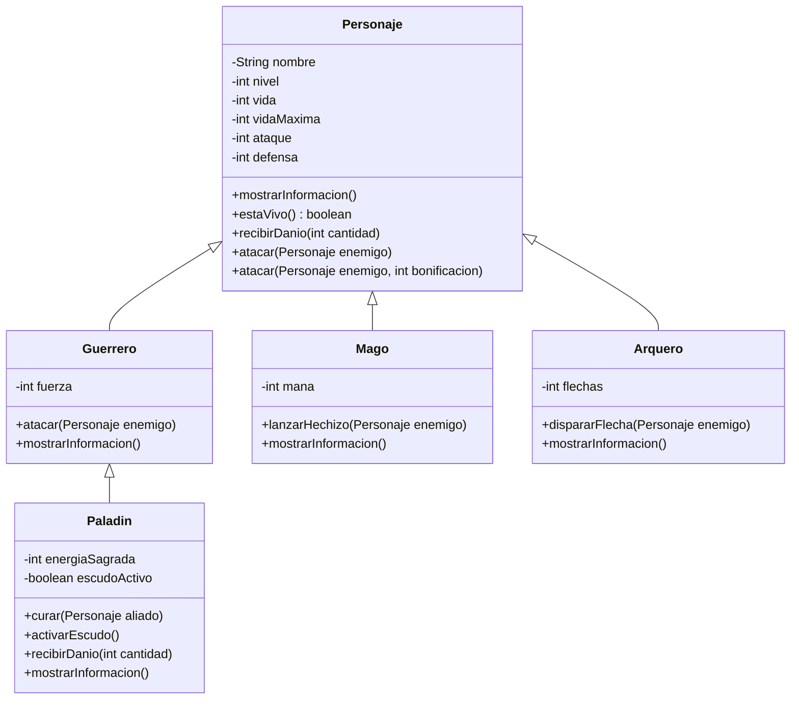

# 🎮 ESFOT RPG: La Batalla de los Reinos

## 📉 Descripción
Prototipo de videojuego de rol (RPG) por consola desarrollado en Java, enfocado en la aplicación práctica de los pilares fundamentales de la Programación Orientada a Objetos (POO): encapsulamiento, herencia (simple, jerárquica y multinivel), sobrescritura, sobrecarga, polimorfismo, casting seguro y manejo de colecciones dinámicas.
---


## 🚀Cómo ejecutarlo

1. Clonar este repositorio en tu equipo local:
```bash
   git clone <URL-DE-TU-REPOSITORIO>
   ```
2. Abrir el proyecto en tu IDE de Java preferido (IntelliJ IDEA, Eclipse, NetBeans o VS Code) o compilar desde la terminal:
```bash
   cd ESFOT-RPG/src
   javac personajes/*.java juego/*.java Main.java
   java Main
   ```
3. Interactuar con el menú numérico ingresando las opciones solicitadas por teclado.
---


## 🗂️ Estructura del proyecto
El código fuente está organizado en paquetes para separar la lógica de negocio de la interfaz por consola:
```text
ESFOT-RPG/
├── src/
│   ├── personajes/
│   │   ├── Personaje.java
│   │   ├── Guerrero.java
│   │   ├── Mago.java
│   │   ├── Arquero.java
│   │   └── Paladin.java
│   ├── juego/
│   │   └── GestorJuego.java
│   └── Main.java
└── README.md
```
---


## 🧬 Modelo de Herencia y Diagrama UML

El diseño del sistema modela tres tipos de herencia:
1. **Herencia Simple:** `Guerrero` extiende directamente de `Personaje`.
2. **Herencia Jerárquica:** Las clases `Guerrero`, `Mago` y `Arquero` comparten una misma clase padre (`Personaje`).
3. **Herencia Multinivel:** `Paladin` extiende de `Guerrero`, el cual a su vez extiende de `Personaje` (`Personaje` -> `Guerrero` -> `Paladin`).



---


## Evidencias
### Creación de personajes

`Guerrero`


`Mago`


`Arquero`


`Paladín`


`Personaje repetido`


`Valores no validos`


### Mostrar personajes


### Búsqueda por nombre


### Atacar a otro personaje


`Ataque con bonificacion`


### Habilidades especiales


`Hechizo con mana y sin mana`


`Disparo de flechas`


`Curar aliado`


### Combate completo


### Personajes vivos


## Preguntas de análisis
1. `¿Dónde se aplica herencia simple en el proyecto?`
Se aplica en varias partes, siendo la clase padre "Personaje" y las clases hijas "Guerrero, Mago, Arquero, Paladín", cada una de forma individual es de herencia simple.

2. `¿Por qué Personaje → Guerrero → Paladin representa herencia multinivel?`
Porque se forma una cadena , donde se van heredando atributos en varios niveles. "Paladín" hereda "Guerrero, y a la vez "Guerrero" hereda "Personaje". Así "Paladín" hereda "Guerrero" y "Personaje" a la vez.

3. `¿Qué relación ejemplifica herencia jerárquica?`
La relación de las subclases "Guerrero, Mago, Arquero y Paladín". Heredan simultáneamente la misma super clase "Personaje". 

4. `¿Cuál es la diferencia entre sobrescritura y sobrecarga de atacar()?`
La sobrecarga es dentro de la misma clase, y pasa al escribir el mismo método pero con una diferencia en los parámetros, pueden haber mas o menos.
La sobreescritura ocurre en una clase hija, en la que se hereda el mismo método del padre, pero se le añade atributos únicos de la clase hija.

5. `¿Qué aporta super en constructores y métodos?`
En los constructores invoca los atributos del constructor padre, así no hay necesidad de volver a asignar estos atributos a la clase hija, ya que toma las validaciones establecidas en la clase padre, pero también se le puede asignar mas atributos únicos de la clase hija.<br>En los metodos sirve de la misma manera, ayuda a reutilizar la lógica del método padre, añadiendo atributos únicos de la clase hija.

6. `¿Por qué List<Personaje> admite guerreros, magos, arqueros y paladines?`
Por el polimorfismo, admite las subclases hijas porque son una extensión de la clase padre, por ende pertenecen a padre, y pueden ser incluidas en la lista del padre.

7. `¿Qué versión de mostrarInformacion() se ejecuta al recorrer la lista y por qué?`
La versión sobre escrita de cada subclase hija, porque, dentro de la lista se encuentra las subclases hijas, tomando los metodos de estas, gracias al enlace dinámico de JAVA.

8. `¿Cuándo se necesita instanceof antes de hacer casting?`
Se necesita cuando manejas un objeto genérico (Personaje) y quieres usar métodos exclusivos de una subclase (como lanzarHechizo o dispararFlecha). El instanceof verifica que el objeto sea del tipo correcto antes de convertirlo, evitando errores fatales en ejecución (ClassCastException).

9. `¿Qué ventaja aporta HashMap para localizar un personaje por nombre?`
Guarda datos en pares, clave-atributo, asi se guarda como clave el nombre del personaje y su atributo es la clase hija del personaje. Haciendo que para encontrar al personaje solo se necesite su nombre, y ya puedo acceder al atributo guardado junto al nombre.

10. `¿Cómo se protege la consistencia de los atributos mediante encapsulamiento?`
 Se protegen declarando los atributos como privade, así cuando se quiera acceder a ellos para lectura o modificación, se debe pasar por getters, setters y metodos ya establecidos en esa clase, con sus respectivas validaciones, funcionando como filtros. 
